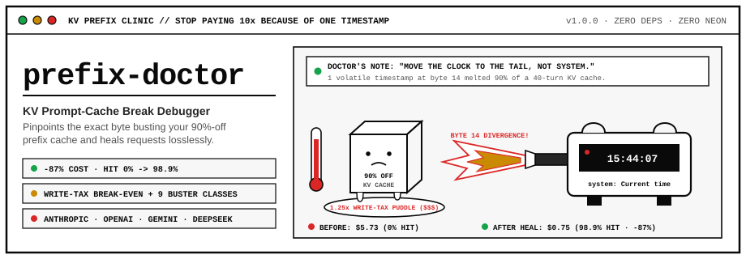
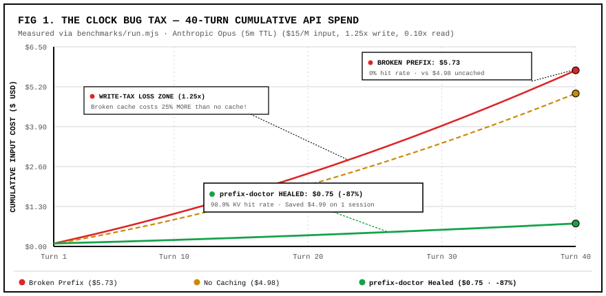
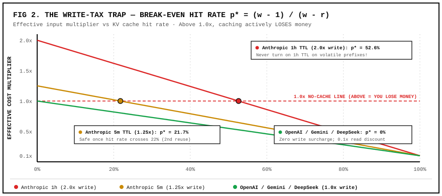
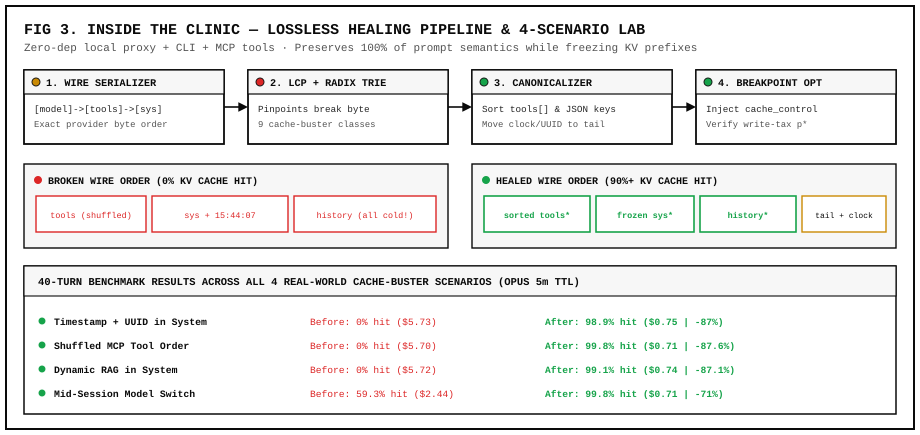
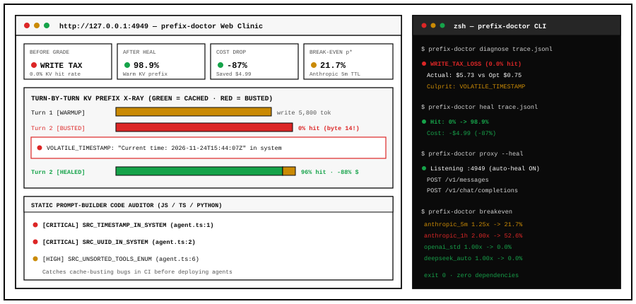

<p align="center">
  
</p>

<p align="center">
  
  
  
  
  
  
</p>

---

## The \$100 Clock Bug: Why Your "90%-Off Prompt Cache" Is Secretly Costing You MORE

Prompt caching on **Anthropic Claude**, **OpenAI GPT**, **Google Gemini**, and **DeepSeek** discounts repeated input tokens by **90%**. Yet in real-world coding agents and agent frameworks, one innocent mistake silently destroys your entire KV prefix cache on every turn:

- Putting `Current time: 2026-11-24T15:44:07Z` or a `request_id` UUID at the top of your `system` prompt.
- Passing MCP `tools[]` from `Object.values(...)` in non-deterministic order (**busts 100% of KV cache at token 0!**).
- Injecting dynamic RAG snippets or `git status` inside `system` instead of appending to the tail.
- Switching models mid-session (cold prefill on target model).

Worse: on write-taxed tiers (**Anthropic 5m `1.25×` write** or **1h `2.0×` write**), a broken cache doesn't just give you 0% savings—**it actively makes your bill 25% to 100% MORE expensive than disabling caching completely!**

**`prefix-doctor`** is a **zero-dependency KV Prompt-Cache Break Debugger, Lossless Prefix Canonicalizer, Static Prompt-Code Auditor, MCP Server & Live Auto-Healing Proxy** built strictly in monochrome black & white (+ Green / Yellow / Red health indicators).

---

## Lab Benchmarks: Real 40-Turn API Cost Breakdown

Every graph and number below comes straight from our deterministic 40-turn coding-agent benchmark (`npm run bench` → [`benchmarks/results.json`](benchmarks/results.json)) modeled on **Anthropic Opus 5m TTL (\$15/M input, 1.25× write, 0.10× read)** across 4 real-world cache-buster scenarios:

| Cache-Buster Scenario | Before Hit Rate | After `prefix-doctor` | Before Cost (40 Turns) | After Cost (40 Turns) | Cost Saved | Write-Tax Loss Before? |
| :--- | :---: | :---: | :---: | :---: | :---: | :---: |
| **Timestamp + UUID in System** | 0.0% | **98.9%** | \$5.73 *(> \$4.59 uncached!)* | **\$0.75** | **-87.0%** (\$4.99) | **YES (RED)** |
| **Shuffled MCP Tool Order** | 0.0% | **99.8%** | \$5.70 *(> \$4.56 uncached!)* | **\$0.71** | **-87.6%** (\$4.99) | **YES (RED)** |
| **Dynamic RAG in System Prompt** | 0.0% | **99.1%** | \$5.72 *(> \$4.58 uncached!)* | **\$0.74** | **-87.1%** (\$4.98) | **YES (RED)** |
| **Mid-Session Model Ping-Pong** | 59.3% | **99.8%** | \$2.44 | **\$0.71** | **-71.0%** (\$1.73) | No (Degraded) |

<p align="center">
  
</p>

---

## The Science: Write-Tax Break-Even Math & Wire-Order Physics

Grounded in late-2026 LLM caching research (detailed formulas in [`docs/CACHE_PHYSICS.md`](docs/CACHE_PHYSICS.md)):
- ***Don't Break the Cache*** ([`arXiv:2601.06007`](https://arxiv.org/abs/2601.06007)) — Long-horizon agent prompt caching evaluation.
- ***Cache-Aware Prompt Compression (CAPC)*** ([`arXiv:2607.15516`](https://arxiv.org/abs/2607.15516)) — Two-tier cost model for API caching.
- ***ShadowPrefill*** ([`arXiv:2611.13176`](https://arxiv.org/abs/2611.13176)) — Eliminating cold-cache prefills under per-step model routing.
- ***Context Has a Price*** ([`arXiv:2611.22238`](https://arxiv.org/abs/2611.22238)) — Prefix cache erosion when adding/mutating context in coding agents.

### The Write-Tax Break-Even Formula

For write multiplier $w$ and read multiplier $r$, caching only saves money when your effective hit rate exceeds:

$$p^* = \frac{w - 1}{w - r}$$

- **Anthropic 5m TTL** ($w = 1.25,\; r = 0.10$): $p^* = \mathbf{21.7\%}$
- **Anthropic 1h TTL** ($w = 2.00,\; r = 0.10$): $p^* = \mathbf{52.6\%}$
- **OpenAI / Gemini / DeepSeek** ($w = 1.00,\; r = 0.10$): $p^* = \mathbf{0.0\%}$

<p align="center">
  
</p>

### Lossless Prefix Canonicalizer & 9-Class Forensic Classifier

<p align="center">
  
</p>

`prefix-doctor` detects 9 exact cache-breaking pathologies (`VOLATILE_TIMESTAMP`, `VOLATILE_UUID_TRACE_ID`, `TOOL_SCHEMA_REORDER`, `JSON_KEY_JITTER`, `TOOL_SCHEMA_MUTATION`, `MUTATED_SYSTEM_PROMPT`, `DYNAMIC_CONTEXT_PREPEND`, `MISSING_CACHE_BREAKPOINT`, `TTL_EXPIRATION`, `MODEL_SWITCH_COLD_PREFILL`) and heals requests **with zero information loss**:
1. Sorts `tools[]` lexicographically & recursively canonicalizes JSON Schema keys.
2. Relocates volatile clocks, UUIDs, trace IDs, and turn counters out of `system` into a `<turn_volatile_metadata>` block **after** the final rolling `cache_control` breakpoint on the latest user turn.
3. Injects optimal explicit `cache_control: { type: "ephemeral" }` breakpoints (`tools` → `system` → rolling history boundary).

---

## Live Monochrome Web Clinic & CLI Preview

<p align="center">
  
</p>

---

## Quick Start & How to Use (60 Seconds)

**Requirement:** Node.js `>= 22.5.0` (zero `npm install` dependencies).

```bash
git clone https://github.com/Moeraafatz/prefix-doctor.git
cd prefix-doctor
npm link

# Self-check Node 22+ & built-in cache healing engine
prefix-doctor doctor
```

### 1. Diagnose & Heal Any `.json` / `.jsonl` API Trace

```bash
# Try built-in realistic broken traces immediately
prefix-doctor diagnose --demo timestamp_buster --provider anthropic_opus_5m
prefix-doctor heal --demo shuffled_mcp_tools --provider anthropic_opus_5m

# Diagnose & heal your own recorded agent session logs
prefix-doctor diagnose ./session-trace.jsonl --provider anthropic_5m
prefix-doctor heal ./session-trace.jsonl --out ./healed-trace.json
```

### 2. Static Audit of Your Agent's Prompt-Builder Code (JS / TS / Python)

Catch `new Date().toISOString()`, `randomUUID()`, `Object.values(tools)`, `messages.unshift()`, and missing `cache_control` **before** shipping:

```bash
prefix-doctor audit-code ./src/
```

### 3. Run as a Live Auto-Healing Local Proxy (`ANTHROPIC_BASE_URL` / `OPENAI_BASE_URL`)

```bash
# Auto-heal live requests & forward transparently upstream
prefix-doctor proxy --port 4949 --heal --upstream https://api.anthropic.com

# Point your agent SDK or CLI at the local proxy
export ANTHROPIC_BASE_URL=http://127.0.0.1:4949
```

### 4. Launch the Optional Monochrome Web Inspector (`prefix-doctor ui`)

```bash
prefix-doctor ui --port 4949 --demo
# Open http://127.0.0.1:4949 — interactive Before/After Heal, turn bars & code auditor
```

### 5. Install Portable `SKILL.md` + 5-Tool MCP Server for Coding Agents

```bash
# Installs into Claude Code, Codex CLI, Cursor, Windsurf & Antigravity
prefix-doctor init all
```

### 6. Print Provider Write-Tax Break-Even Table

```bash
prefix-doctor breakeven
```

---

## Best-Case Use Cases

1. **Slashing Production Agent API Bills by 70–88% Overnight:** Run `prefix-doctor diagnose` on 10 recorded multi-turn sessions to catch silent `Current time:` or shuffled MCP tool bugs burning 1.25× write tax on every turn.
2. **Zero-Code Drop-In Live Proxy Healing:** Place `prefix-doctor proxy --heal` in front of Anthropic or OpenAI during local development to canonicalize third-party MCP tool ordering automatically.
3. **CI/CD Prompt Hygiene Gate (`audit-code`):** Fail PRs whenever someone interpolates `Date.now()` / `uuid4()` into a system prompt or calls `messages.unshift()` on conversation history.
4. **Anthropic 5m vs. 1h TTL Decision Engineering:** Check exact break-even thresholds (`21.7%` vs `52.6%`) before enabling 2.0× 1-hour caching so long-TTL writes never backfire financially.
5. **Teaching Coding Agents Cache-Safe Architecture (`init all`):** Drop `skills/prefix-doctor/SKILL.md` into your repo so Claude Code, Codex CLI, and Cursor write cache-friendly prompts and MCP servers by default.

---

## Indicator Legend (Strict Monochrome + Traffic Light)

| Indicator | State | Meaning |
| :---: | :--- | :--- |
| **GREEN** (`#16A34A`) | `CACHED` / `HEALTHY` | Warm KV hit rate $\ge 75\%$; enjoying 90%-off read multiplier. |
| **YELLOW** (`#CA8A04`) | `WARMUP` / `DEGRADED` | Hit rate $25\% - 74\%$ or approaching write-tax break-even $p^*$. |
| **RED** (`#DC2626`) | `BUSTED` / `WRITE_TAX_LOSS` | Early prefix break ($< 25\%$ hit) or actively paying MORE than uncached pricing. |

---

## Verification & Reproducibility

```bash
npm test        # 9 unit & integration tests (LCP, breakpoints, canonicalizer, proxy, code audit, MCP)
npm run bench   # Re-runs 40-turn multi-scenario benchmark -> benchmarks/results.json
npm run assets  # Re-generates all 5 XML-valid monochrome B&W SVGs from benchmarks/results.json
```

---

## Academic References

- ***Don't Break the Cache: An Evaluation of Prompt Caching for Long-Horizon Agentic Tasks*** — [`arXiv:2601.06007`](https://arxiv.org/abs/2601.06007) (Jan 2026).
- ***Cache-Aware Prompt Compression: A Two-Tier Cost Model for LLM API Caching*** — [`arXiv:2607.15516`](https://arxiv.org/abs/2607.15516) (Jul 2026).
- ***SHADOWPREFILL: Keeping Your Next Model Warm for Per-Step Model Routing in Agentic LLM Serving*** — [`arXiv:2611.13176`](https://arxiv.org/abs/2611.13176) (Nov 2026).
- ***Context Has a Price: Adding and Removing Context for LLM Coding Agents under Prefix Caching*** — [`arXiv:2611.22238`](https://arxiv.org/abs/2611.22238) (Nov 2026).

---

## License

MIT © [RAFBUG (Moeraafatz)](LICENSE)
